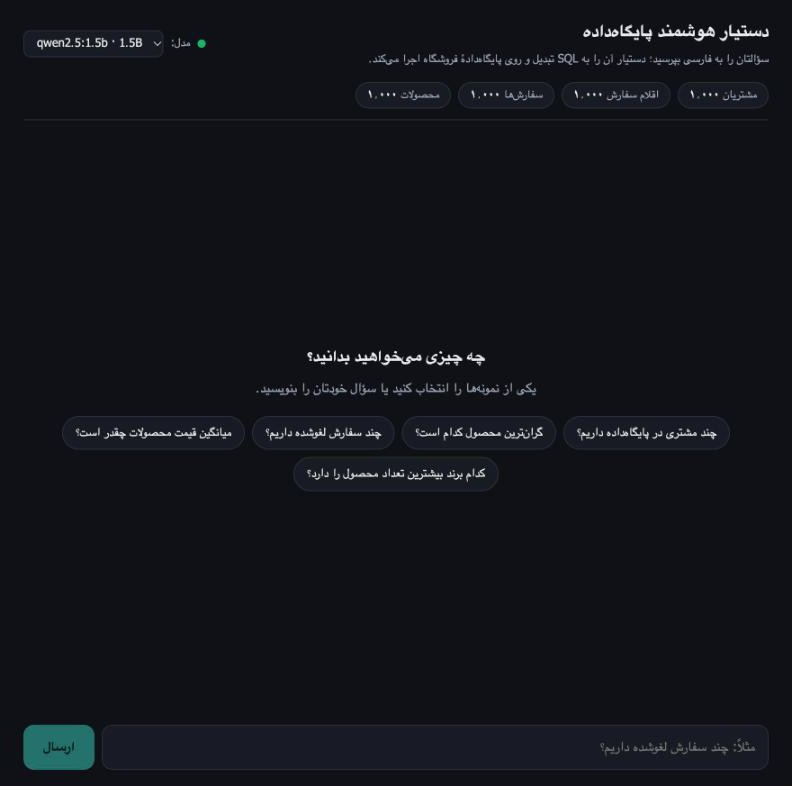
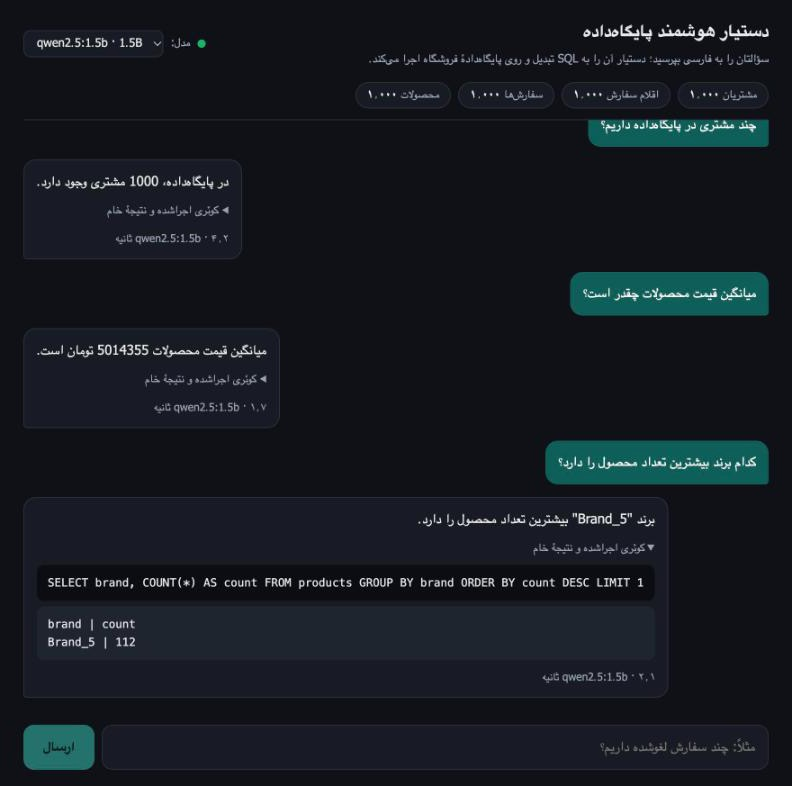
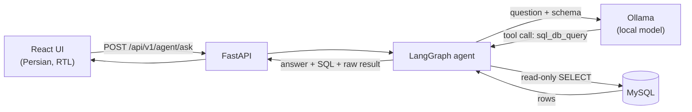

# AI Database Agent

Ask your database questions in plain Persian and get answers back in Persian. Everything runs on your own machine:
a local [Ollama](https://ollama.com) model turns the question into SQL, a LangGraph agent runs it against MySQL in
read-only mode, and a React chat UI shows the answer together with the exact query and raw result behind it.


| Start screen | A conversation, with the executed SQL expanded |
| :---: | :---: |
|  |  |

## Features

- **Natural language to SQL**: questions in Persian (or English) are converted into MySQL `SELECT` queries and executed.
- **Fully local**: no API key and no data leaving your machine. The LLM is served by Ollama.
- **Automatic model discovery**: the app asks Ollama which models are installed, skips embedding-only models, and
  picks the largest one that supports tool calling. You can switch models from the UI.
- **Verifiable answers**: every answer comes with the SQL that was run and the raw rows the database returned,
  so you never have to take the model's wording on trust.
- **Read-only by construction**: only a single `SELECT` is accepted, and it runs inside a MySQL read-only transaction.
- **Persian, right-to-left UI**: a React chat interface with light and dark themes that follow your system setting.
- **Works with small models**: if a model writes the SQL as plain text instead of a proper tool call, the agent
  still executes it.

## How It Works



1. The UI sends the question to the API, optionally naming an Ollama model.
2. The agent gives the model the database schema and the question.
3. The model calls the `sql_db_query` tool with a `SELECT` statement. The tool checks it, runs it in a read-only
   transaction, and returns the rows as a small text table.
4. The model reads the result and writes a short answer in Persian. If a query fails, the error is returned to
   the model so it can correct the query and try again (up to a fixed number of rounds).
5. The API returns the answer plus every query that was executed and its raw result.

## Technology Stack

| Layer | Tools |
| --- | --- |
| Backend | FastAPI, Pydantic, SQLAlchemy |
| Agent | LangChain, LangGraph, `langchain-ollama` |
| Model runtime | Ollama (any chat model with tool-calling support) |
| Database | MySQL 8.0 |
| Frontend | React 19, Vite |
| Tooling | Docker Compose, Pytest |

## Getting Started

### Prerequisites

- Docker with Docker Compose (for MySQL)
- Python 3.10+
- Node.js 20+
- [Ollama](https://ollama.com) running locally, with at least one chat model that supports tool calling:

  ```bash
  ollama pull qwen2.5:7b
  ```

### 1. Clone the repository

```bash
git clone https://github.com/parvvaresh/langchain-sql-agent.git
cd langchain-sql-agent
```

### 2. Create the `.env` file

```env
# MySQL database settings
DB_HOST=db
DB_PORT=3306
DB_USER=user
DB_PASSWORD=your_db_password
DB_NAME=shop_db
```

`DB_NAME` must be `shop_db`, the database created by `data/init.sql`.

### 3. Start and seed the database

```bash
docker-compose up -d db
```

On first start MySQL runs `data/init.sql`, which creates four tables (`customers`, `products`, `orders`,
`order_items`) and fills each one with 1,000 generated rows. The database is exposed on `localhost:3307`.

### 4. Install the backend

```bash
python -m venv .venv
source .venv/bin/activate
pip install -r requirements.txt
```

### 5. Build the UI

```bash
cd frontend
npm install
npm run build
cd ..
```

### 6. Run the application

```bash
DB_HOST=127.0.0.1 DB_PORT=3307 uvicorn app.main:app --port 8000
```

`DB_HOST` and `DB_PORT` are overridden here because the app runs on the host, while `.env` holds the values used
inside Docker.

Open **http://localhost:8000/ui/** and ask a question.

| Address | What it serves |
| --- | --- |
| http://localhost:8000/ui/ | Chat UI |
| http://localhost:8000/docs | Interactive API documentation (Swagger UI) |
| http://localhost:8000/ | Health check |

## Choosing a Model

The model picker lists every installed Ollama chat model. Models without tool-calling support are shown but
disabled, and embedding models are hidden. When no model is selected, the largest tool-capable model is used;
set `OLLAMA_MODEL` to pin a specific one.

Model size matters a lot here. The screenshots above were taken with `qwen2.5:1.5b`, a very small model. It
handles simple counts, sums, averages and "top one" questions, but it often gets joins wrong and its Persian
wording can be awkward or occasionally inaccurate. A larger model such as `qwen2.5:7b` is a better starting
point. Whatever model you use, expand **«کوئری اجراشده و نتیجهٔ خام»** under an answer to check the query and the
real numbers.

After pulling a new model with `ollama pull`, reload the page and it appears in the picker.

## Configuration

Settings are read from environment variables and from `.env`.

| Variable | Default | Description |
| --- | --- | --- |
| `DB_HOST` | `localhost` | MySQL host (`db` inside Docker Compose) |
| `DB_PORT` | `3306` | MySQL port (`3307` when connecting from the host to the Compose database) |
| `DB_USER` | required | MySQL user |
| `DB_PASSWORD` | required | MySQL password |
| `DB_NAME` | required | Database name (`shop_db`) |
| `OLLAMA_BASE_URL` | `http://localhost:11434` | Address of the Ollama server |
| `OLLAMA_MODEL` | auto-detected | Model used when a request does not name one |

## API

### `POST /api/v1/agent/ask`

```bash
curl -X POST http://localhost:8000/api/v1/agent/ask \
  -H "Content-Type: application/json" \
  -d '{"query": "گران‌ترین محصول کدام است؟"}'
```

Request fields:

| Field | Required | Description |
| --- | --- | --- |
| `query` | yes | The question, in natural language |
| `session_id` | no | An identifier echoed back in the response |
| `model` | no | Ollama model to use; auto-detected when omitted |

Response:

```json
{
  "response": "گران‌ترین محصول است Product_183 که قیمت آن 10098000 تومان است.",
  "session_id": "default_session",
  "model": "qwen2.5:1.5b",
  "sql_queries": [
    {
      "query": "SELECT name, price FROM products ORDER BY price DESC LIMIT 1",
      "result": "name | price\nProduct_183 | 10098000"
    }
  ]
}
```

### `GET /api/v1/agent/models`

Lists the chat models installed in Ollama and the one used by default.

```json
{
  "models": [
    { "name": "qwen2.5:1.5b", "size": 986061892, "parameter_size": "1.5B", "supports_tools": true }
  ],
  "default": "qwen2.5:1.5b"
}
```

### `GET /api/v1/agent/stats`

Returns the number of rows in each table.

```json
{ "tables": { "customers": 1000, "order_items": 1000, "orders": 1000, "products": 1000 } }
```

## Safety

The agent can only read data:

- The query tool rejects anything that is not a single `SELECT` (or `WITH ... SELECT`) statement.
- Each query runs inside `START TRANSACTION READ ONLY`, so MySQL itself refuses writes.
- Results are capped at 50 rows, which keeps a broad query from flooding the model's context.
- The number of model and tool rounds per question is limited, so a confused model cannot loop forever.

## Frontend Development

For hot reload while working on the UI, run the Vite dev server instead of building:

```bash
cd frontend
API_TARGET=http://127.0.0.1:8000 npm run dev
```

The dev server proxies `/api` to the backend at `API_TARGET` (default `http://127.0.0.1:8000`). The production
build in `frontend/dist` is served by FastAPI under `/ui`.

## Running the API in Docker

`docker-compose up --build` starts both MySQL and the API in containers. The API container reaches Ollama on the
host through `host.docker.internal`. The Docker image does not build the React UI, so use the local setup above
when you want the chat interface.

```bash
docker-compose up --build   # start
docker-compose down         # stop
docker-compose down -v      # stop and delete the database volume
```

## Tests

The tests call the real database and the local model, so start MySQL and Ollama first:

```bash
docker-compose up -d db
DB_HOST=127.0.0.1 DB_PORT=3307 pytest
```

Tests that need a model are marked `ollama`. To run only the ones that need just the database:

```bash
DB_HOST=127.0.0.1 DB_PORT=3307 pytest -m "not ollama"
```

## Continuous Integration

GitHub Actions (`.github/workflows/main.yml`) runs on every push and pull request to `main`:

- **Backend**: lints with flake8, starts a MySQL service seeded from `data/init.sql`, and runs the tests that
  do not need a model.
- **Frontend**: installs the dependencies with `npm ci` and builds the React app.
- **Docker**: builds the image on pushes to `main`, after the two jobs above pass.

## Project Structure

```
langchain-sql-agent/
├── app/
│   ├── main.py                 # FastAPI application entry point; serves the built UI under /ui
│   ├── agent/
│   │   ├── agent_service.py    # Prompt construction and agent execution
│   │   ├── graph.py            # LangGraph workflow definition
│   │   ├── ollama_models.py    # Discovery of local Ollama models
│   │   └── tools.py            # Read-only SQL query tool
│   ├── api/
│   │   ├── router.py           # API router configuration
│   │   └── endpoints/
│   │       └── agent.py        # /ask, /models and /stats endpoints
│   ├── core/
│   │   └── config.py           # Application configuration
│   ├── database/
│   │   └── session.py          # Database engines and sessions
│   ├── models/
│   │   └── shop.py             # SQLAlchemy models
│   └── schemas/
│       └── agent.py            # Pydantic request and response schemas
├── frontend/                   # React (Vite) chat UI
│   ├── index.html
│   ├── vite.config.js
│   └── src/
│       ├── App.jsx             # Chat screen and its components
│       ├── api.js              # Calls to the backend
│       ├── main.jsx
│       └── styles.css
├── data/
│   └── init.sql                # Schema and seed data
├── docs/
│   └── screenshots/
├── test/
│   ├── conftest.py
│   └── test_agent.py
├── docker-compose.yml
├── Dockerfile
└── requirements.txt
```

## Troubleshooting

**The model picker says «Ollama در دسترس نیست».**
Ollama is not reachable. Check that it is running (`ollama list`) and that `OLLAMA_BASE_URL` points to it.

**The model picker says «مدل مناسبی پیدا نشد».**
No installed model supports tool calling. Pull one, for example `ollama pull qwen2.5:7b`.

**`Unknown MySQL server host 'db'` on startup.**
The app is running on the host with the Docker hostname from `.env`. Start it with
`DB_HOST=127.0.0.1 DB_PORT=3307`.

**`/ui/` returns 404.**
The UI has not been built. Run `npm install && npm run build` in `frontend/`, then restart the app.

**The database is empty or the seed data changed.**
`data/init.sql` only runs when the volume is created. Recreate it with
`docker-compose down -v && docker-compose up -d db`.

**Answers are wrong or oddly phrased.**
Expand the executed query under the answer to see what actually ran, then try a larger model.

## License

Released under the [MIT License](LICENSE).
